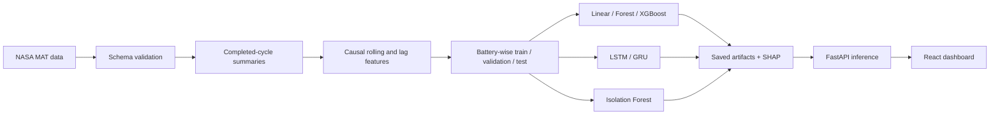
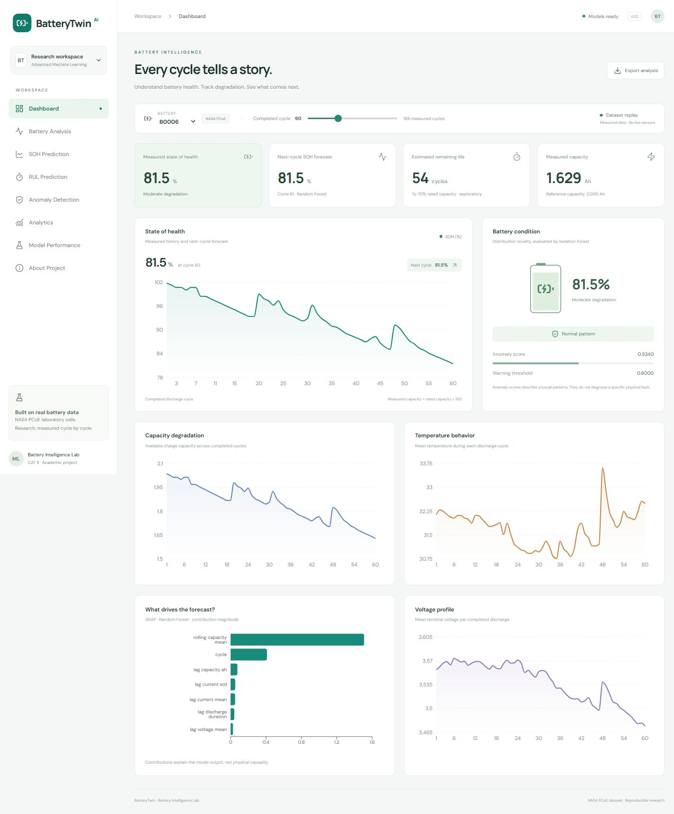

# BatteryTwin

**AI-Based EV Battery Health Monitoring and Battery Anomaly Detection**  
19MAM56 - Advanced Machine Learning Lab CAT II academic project

BatteryTwin is a working research application: real NASA battery data is processed into causal features, models are trained offline, and Streamlit presents saved-model predictions in the primary dashboard. The original FastAPI/React interface is retained for API demonstrations. It estimates next-cycle SOH, provides exploratory remaining-cycle estimates, and detects unusual operating patterns. It does not diagnose physical EV battery faults.

## Run the Streamlit project

```powershell
.venv/Scripts/python.exe -m pip install -r requirements-streamlit.txt
./start-streamlit.ps1
```

Open http://127.0.0.1:8501. Seven views cover Dashboard, Predictions, Charge Tracking, Life Planning, Analytics, Model Performance, and About & Requirements. Custom JSON uploads and sensor controls use the same strict schemas and saved models as FastAPI.

The primary `Dockerfile` now serves Streamlit on port 7860 with a UID 1000 user and artifact preflight. `docker compose up --build -d` maps host port 8501. `./deploy-docker.ps1` verifies container health and actual model inference when Docker's engine is available. The older API container is preserved as `Dockerfile.api` and `docker-compose.api.yml`.

Hugging Face packaging: `python scripts/prepare_space.py` stages the runtime allowlist under `output/huggingface-space/`. Uploaded to the previously approved existing Space [sasi468896/aml_cat](https://huggingface.co/spaces/sasi468896/aml_cat), using the current `sasi468896` login. Update it with `.venv/Scripts/python.exe scripts/publish_space.py --repo sasi468896/aml_cat --update`. No credentials, local logs or personal lab records are uploaded.

Actual status: all 37 automated tests pass, including nine Streamlit UI tests. Local Streamlit is verified. All 109 runtime files were uploaded on October 15, 2026 (commit `ab5ba052e5779c10652fb32747324213a5895f23`); the Space uses Docker SDK. Runtime is CONFIG_ERROR because its existing ZeroGPU hardware supports Gradio only. Switching to CPU Basic returned HTTP 402 requiring PRO. Hugging Face runtime remains blocked. AWS Docker deployment is verified; see the ECR/ECS section below. See `artifacts/results/huggingface_deployment.json`. Local Docker's engine also remains unavailable.

## Original FastAPI / React interface

The trained artifacts and dashboard build are included in this workspace. In PowerShell, run:

```powershell
./start.ps1
```

Open **http://127.0.0.1:8000**. The eleven views include Dashboard, Battery Analysis, SOH Prediction, RUL Prediction, Anomaly Detection, Analytics, Model Performance, About Project, Charge Tracking, Life Planning, and Project Requirements. The API reference is **http://127.0.0.1:8000/docs**.

## Problem and objectives

Repeated cycling changes lithium-ion battery capacity and sensor behavior. The project studies whether prior discharge cycles support useful short-term health forecasts, compares advanced models with simple baselines, and makes the evidence inspectable. Outputs distinguish measured current health, learned next-cycle forecasting, exploratory RUL, and unsupervised anomalies.

## Dataset and scientific definitions

- [NASA Li-ion Battery Aging Datasets](https://catalog.data.gov/dataset/li-ion-battery-aging-datasets): 636 measured discharge cycles from B0005, B0006, B0007 and B0018.
- `scripts/download_data.py` caches MAT files from a pinned public mirror revision. `data/raw/manifest.json` records URLs, revision, file sizes and SHA256 checksums. Repeated runs reuse and verify the cache.
- Actual fields are inspected and saved in `artifacts/results/source_schema.json`. Voltage, current, temperature, elapsed discharge time and capacity are extracted. No unavailable charge or resistance columns are invented.
- **SOH = measured discharge capacity / 2.0 Ah rated capacity × 100.** Values above 100% can occur; they are not clipped.
- **EOL = first observed discharge at or below 70% rated capacity (1.4 Ah)**, following NASA's documented 30% fade experiment. This is a dataset-specific criterion.
- RUL = `max(first_EOL_cycle - target_cycle, 0)` only for cells with an observed crossing. B0007 is right-censored and supplies no supervised RUL labels.
- Health display thresholds (90/80/70%) are project conventions in `configs/config.yaml`, not universal industry standards.

## Architecture



Preprocessing validates missing fields, finite sensor values, plausible units, cycle identifiers and duplicates. IQR outliers are reported and retained because real degradation and capacity recovery are informative. The model pipelines fit median imputation and scaling on training batteries only. Sequences never cross a battery boundary.

Cycle `t` forecasts use completed observations up to `t-1`, including previous measured capacity, causal rolling mean/std, previous capacity change and previous voltage/current/temperature summaries. The target-cycle capacity never enters its features. This is **one-step forecasting with measured history**, not an open-loop long-horizon capacity forecast or prediction from instantaneous sensors.

Train cells: **B0005 + B0007**. Validation: **B0018**. Test: **B0006**. All SOH model benchmarks share target cycles 9-168 of B0006 (160 predictions). Optuna and model selection use validation performance only. Hyperparameter studies are deliberately small (8 tree trials and 4 LSTM trials) for an executable academic example. This is not an exhaustive architecture search.

## Models, optimization and explainability

- Linear Regression, Random Forest, XGBoost and PCA + Linear Regression.
- Configurable PyTorch LSTM and GRU, train-only scaling, early stopping, ReduceLROnPlateau and gradient clipping.
- Optuna optimizes tree depth/size/learning rate/subsampling and LSTM width/layers/dropout/learning rate/batch size. Sequence length is configurable.
- Isolation Forest with warning/anomalous thresholds from validation score percentiles (90th / 97.5th). Scores are novelty, not fault probabilities; no precision/recall is claimed without labels.
- RUL Random Forest and RUL LSTM using observed EOL labels; a separate recent linear trend extrapolation is descriptive. No arbitrary confidence intervals are generated.
- SHAP global, dependence and additive local explanations. Local dashboard explanations correspond to the selected SOH model.
- Durable JSONL experiment logs include parameters, dataset manifest, metrics, duration and model paths. Optional MLflow activates if separately installed. Fallback logging is used in the supplied environment.
- PCA reports component variance and 90/95% component counts; 25 analytical plots are included.

## Actual executed results

See `artifacts/results/benchmark.csv` for measured timing, MAPE, validation MAE and sample count. MAE/RMSE are percentage points for SOH and cycles for RUL.

| Model | Task | MAE | RMSE | R² |
|---|---|---:|---:|---:|
| Linear Regression | SOH | 1.526 | 1.671 | 0.980 |
| Random Forest | SOH | 1.682 | 2.472 | 0.956 |
| PCA + Linear | SOH | 1.021 | 1.553 | 0.982 |
| XGBoost | SOH | 1.598 | 2.442 | 0.957 |
| Persistence | SOH | **0.720** | **1.188** | **0.990** |
| LSTM | SOH | 3.097 | 3.670 | 0.902 |
| GRU | SOH | 8.747 | 10.053 | 0.265 |
| RUL Random Forest | RUL | 6.429 | 8.796 | 0.931 |
| RUL LSTM | RUL | 9.828 | 14.785 | 0.805 |
| Gaussian Process | RUL | 11.201 | 13.172 | 0.845 |

**Persistence beats the learned SOH models in the main benchmark.** The dashboard deploys Random Forest because it has the lowest validation MAE among eligible tabular learned models; it is not claimed to be the best test-time method. An independently implemented cycle + two-lag linear baseline inspired by [this open-source benchmark](https://github.com/amirhossein-sadeghi2003/battery-health-forecasting-baselines) achieves MAE **0.684** under our held-out split. The source repository uses a different split and first-capacity normalization, so its reported numbers are contextual, not directly comparable. See `artifacts/results/external_benchmark.json` and the report.

Error analysis includes early-life, near-EOL, high-temperature, large-residual and held-out-battery tables. RUL has only one observed-EOL training cell; its scores should be interpreted cautiously. There is one test cell, so this evaluation cannot establish broad EV generalization.

## Adaptations from your supplied reference

See [the reference comparison](docs/REFERENCE_COMPARISON.md) for inspected source files and differences. The independent extensions add a Gaussian RUL benchmark and actual model-conditional ranges (nominal 90%, observed coverage only **26.25%**), discharge-relative charge tracking using Random Forest and GRU, capacity-derived confusion/ROC/PR plots, utilization planning and a course-requirement evidence page. NASA has no measured SOC or physical fault labels. Planning does not validate lifetime gains.

The charge forest achieves 3.021-point MAE and the charge GRU 3.962-point MAE on 2,748 common held-out samples against a derived coulomb-count reference. These results are separate from next-cycle SOH benchmarks.

## Reproduce from scratch

Python 3.12 and Node 22 are recommended. Setup:

```powershell
python -m venv .venv
.venv/Scripts/Activate.ps1
python -m pip install -r requirements.txt
python scripts/download_data.py
python scripts/prepare_data.py
python -m pytest tests/test_data.py -q
python scripts/train.py
python scripts/evaluate.py
python scripts/reference_extensions.py
python -m pytest -q
cd frontend
npm ci
npm run build
cd ..
python scripts/build_report.py
python scripts/audit_requirements.py
python -m uvicorn api.main:app --host 127.0.0.1 --port 8000
```

On Linux/macOS use `source .venv/bin/activate`. A CPU-only Torch wheel can be installed separately from the official CPU index before the remaining requirements. `requirements.txt` pins direct libraries; `requirements-lock.txt` records the executed environment. Seeds, settings and thresholds are in `configs/config.yaml`; library and platform versions are in `artifacts/logs/environment.json`.

For frontend development, use `npm run dev` in `frontend/` and keep the backend on port 8000. Set `VITE_API_URL` only if serving the dashboard against a separate API origin. By default production serves both from one origin.

## API

| Endpoint | Purpose |
|---|---|
| GET `/` | Built dashboard |
| GET `/health` | Saved-model readiness; 503 if unavailable |
| GET `/model-info` | Features, model selection, configuration and provenance |
| GET `/batteries` | Dataset-backed battery list |
| GET `/batteries/{id}?through_cycle=60` | Measured consecutive cycle history |
| POST `/predict/soh` | Next-cycle SOH and local explanation |
| POST `/predict/rul` | Exploratory remaining cycles |
| POST `/detect/anomaly` | Novelty score and threshold status |
| POST `/analysis` | Combined inference |
| GET `/benchmark`, `/analytics` | Actual experiment results |
| GET `/reference-results` | Gaussian/charge/health results and rubric evidence |
| GET `/batteries/{id}/discharge?cycle=60` | Measured discharge trace with derived reference and trained predictions |
| POST `/predict/soc` | Derived charge proxy from ordered V/I/T/time readings |
| POST `/plan/lifetime` | Fixed remaining-cycle budget converted to usage scenarios |

Each endpoint also has a `/api` alias for the frontend. POST body: `{"battery_id":"B0006","history":[...]}`. Each history row includes `cycle`, `capacity_ah`, voltage min/mean/max/std, current mean/std, temperature mean/max/std and `discharge_duration`. Strict schemas reject invalid or inconsistent inputs; at least 8 consecutive completed cycles enables sequence prediction. The sample history endpoint produces a valid payload after removing its `source` field. Swagger documents the full schema. No retraining occurs during inference.

## Docker and cloud

On Windows, once Docker Desktop is running, use `./deploy-docker.ps1`. It builds and starts Streamlit on port 8501, waits for health, and verifies an actual prediction. See `docs/DEPLOYMENT.md` for the current Docker startup blocker.

```sh
docker build -t batterytwin .
docker run --rm -p 8501:7860 batterytwin
docker compose up --build
```

See [deployment instructions](docs/DEPLOYMENT.md) for Docker, Hugging Face Spaces and AWS EC2. Docker files are provided; consult `artifacts/results/verification.json` for actual verification status. Public hosting is verified on [AWS ECS Fargate](http://3.238.69.149:7860) using the private ECR image. Hugging Face remains blocked by its hardware/plan restriction. A separate public GitHub repository has not been published.

## Repository

```text
api/                    Validated saved-model inference
src/data/               Schema inspection, validation, causal engineering
src/models/             Baseline, boosting, LSTM/GRU, anomaly, RUL
src/evaluation/         Metrics, SHAP, EDA and error plots
src/utils/              Configuration and experiment tracking
scripts/                Download, prepare, train, evaluate, report, package
frontend/               React + Vite dashboard
configs/config.yaml     Seeds, batteries, thresholds and training settings
data/raw/               NASA MAT cache and provenance manifest
data/processed/         Cycle and forecasting-feature tables
models/                 Fitted pipelines, recurrent checkpoints and schema
artifacts/              Actual benchmarks, plots, Optuna and experiment logs
notebooks/              Three executable exploration notebooks
tests/                  Data, inference, validation and readiness tests
docs/                   Deployment, references, viva and submission notes
output/pdf/             IEEE-style project report
```

## Report and screenshots

The report is generated from actual result files by `scripts/build_report.py` and saved as `output/pdf/BatteryTwin_IEEE_Report.pdf`. Figure assets and evaluation tables can be used in the presentation. Dashboard screenshots are saved under `artifacts/screenshots/`.



## Limitations and future work

Four laboratory cells cannot establish EV pack safety or fleet generalization. Previous measured capacity is a strong input and persistence is difficult to beat in a one-step task. RUL learns from one uncensored training cell. Anomaly detection has no fault ground truth. Gaussian model-conditional ranges have poor observed coverage and are not calibrated. There are no live sensors, authentication or multi-tenant device management. Future work: larger battery-held-out validation, pack telemetry domain adaptation, censored survival models, recursive horizon evaluation, independent calibration cells and labeled-fault evaluation.

The local Docker engine remains unavailable. The Docker image was built and tested in AWS CodeBuild and is running successfully on ECS Fargate.

References and DOI/source links are recorded in `docs/references.json`. Use the [submission checklist](docs/SUBMISSION_CHECKLIST.md) to finish author details and verified public links.

## AWS Docker deployment

The AWS launcher builds the Streamlit Docker image on an Ubuntu Lightsail server, so local Docker is optional. Review [the AWS guide](docs/AWS_DEPLOYMENT.md) and `output/aws/deployment-plan.json`. Run `.venv/Scripts/python.exe scripts/deploy_aws.py` to prepare files offline, `--plan` for read-only AWS checks, and `--apply` only after launch approval. The proposed instance bundle is capped at $24/month before taxes and excess usage. This Lightsail alternative was not launched. The approved ECR/ECS deployment below is running. See `artifacts/results/aws_deployment.json`.

## Current AWS approach: Amazon ECR + ECS

The requested AWS route now uses a private ECR image repository, CodeBuild for remote Docker build/inference checks, and ECS Fargate for Streamlit hosting. [Read the deployment guide](docs/AWS_ECR_DEPLOYMENT.md). Run `.venv/Scripts/python.exe scripts/deploy_ecr.py` to prepare reviewable local templates. Deployment costs are approved and both AWS templates passed server-side validation. Docker build, model inference and container health checks passed. The image is stored in private ECR and is running on [ECS Fargate](http://3.238.69.149:7860); the public dashboard and edited-capacity prediction were verified in the browser. The estimated running cost is $31.40/month for compute and public IPv4, plus storage, logs, builds, transfer and taxes. Eight deployment guard tests pass. The earlier Lightsail plan is an unused alternative.

AWS deployment evidence: `artifacts/results/aws_ecr_deployment.json`. The public address is HTTP and may change when ECS replaces the task. The approved service continues to incur charges until stopped or deleted.
